<div align="center">


# Primer Commit · Frontend

**Una comunidad para dar el primer paso en el mundo tech.**
Eventos, prácticas y empleo junior, un foro para resolver dudas entre todas y todos, rutas de aprendizaje, noticias explicadas,
glosario y testimonios reales. En castellano, catalán e inglés.

[**primercommit.es**](https://primercommit.es) · [Backend](https://github.com/nexus-event-app/nexus-backend) ·
[Contrato de la API](https://github.com/nexus-event-app/nexus-backend/blob/dev/docs/API.md)

[](https://github.com/nexus-event-app/nexus-frontend/actions/workflows/ci.yml)


</div>

<p align="center">
  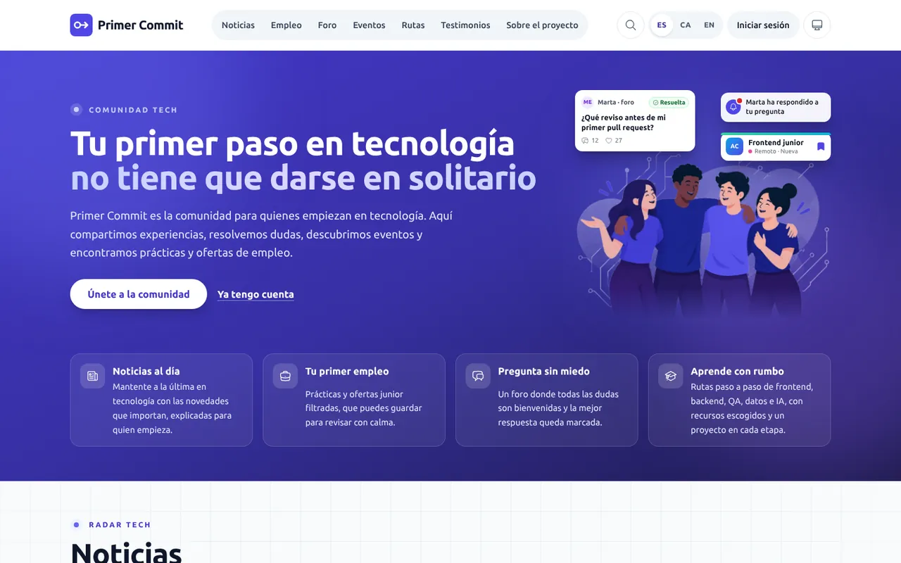
</p>

---

## Índice

- [Qué es Primer Commit](#qué-es-primer-commit)
- [Capturas](#capturas)
- [Funcionalidades](#funcionalidades)
- [Stack y principios](#stack-y-principios)
- [Puesta en marcha](#puesta-en-marcha)
- [Scripts](#scripts)
- [Calidad: pruebas, accesibilidad y CI](#calidad-pruebas-accesibilidad-y-ci)
- [Arquitectura](#arquitectura)
- [Idiomas](#idiomas)
- [Variables de entorno](#variables-de-entorno)
- [Despliegue](#despliegue)
- [SEO](#seo)
- [Decisiones de diseño](#decisiones-de-diseño)

## Qué es Primer Commit

Empezar en tecnología cuesta: casi todas las ofertas piden experiencia, la información está dispersa y da vergüenza
preguntar lo «básico». Primer Commit reúne en un solo sitio lo que más ayuda al empezar, con una comunidad que está en
el mismo punto. Es un proyecto **independiente y sin ánimo de lucro**: sin publicidad, sin cookies de seguimiento y
sin vender datos.

Este repositorio es la web (SPA en React). La API, la base de datos, la importación de noticias y ofertas y el
despliegue viven en [nexus-backend](https://github.com/nexus-event-app/nexus-backend).

## Capturas

| Eventos | Empleo |
| :---: | :---: |
| 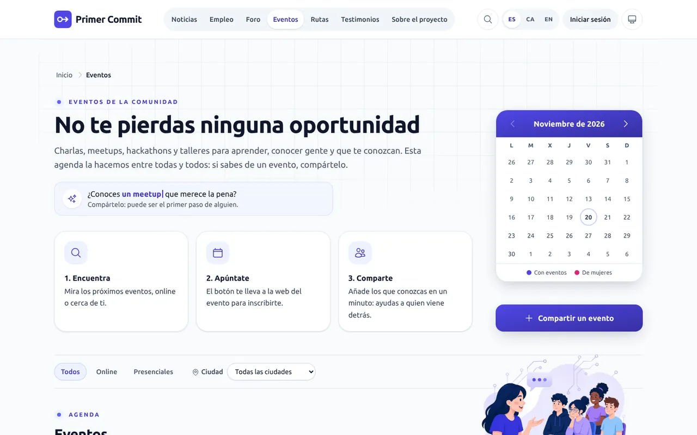 | 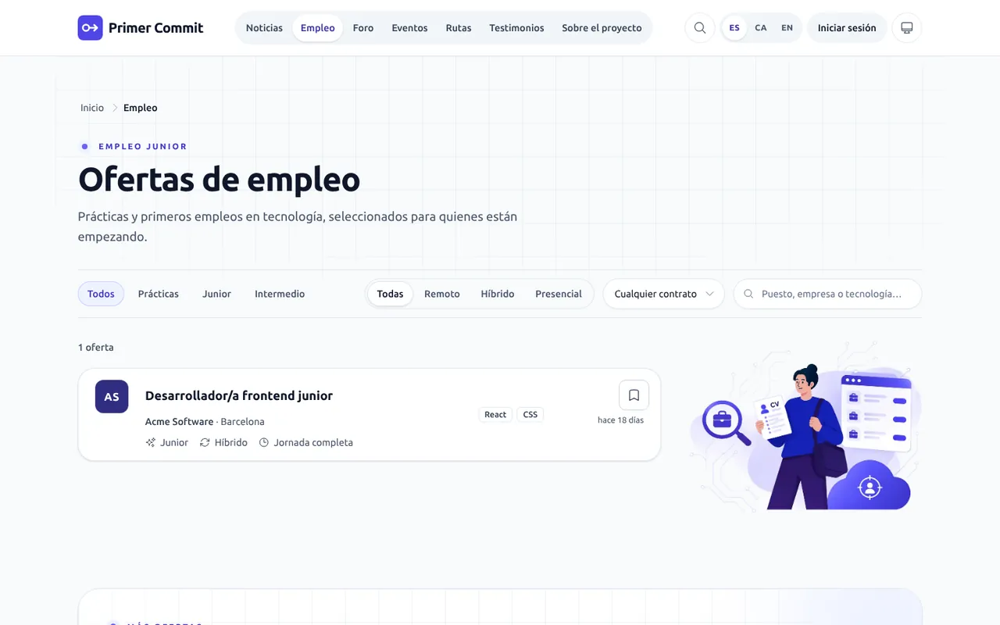 |
| **Foro** | **Rutas de aprendizaje** |
| 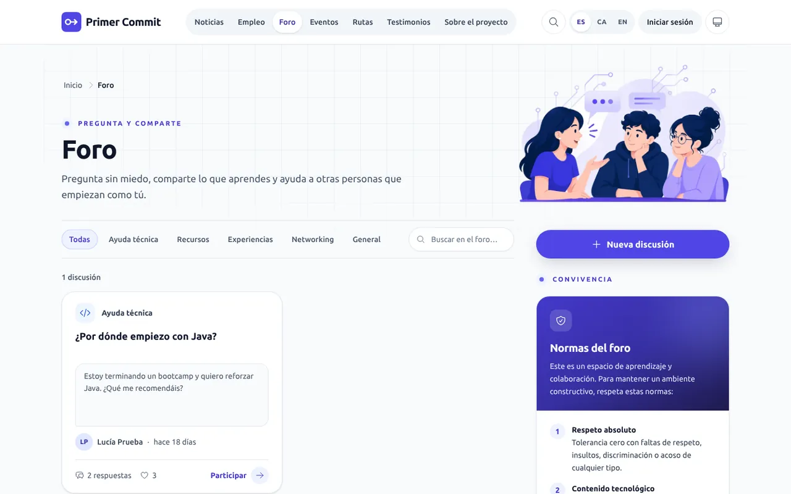 | 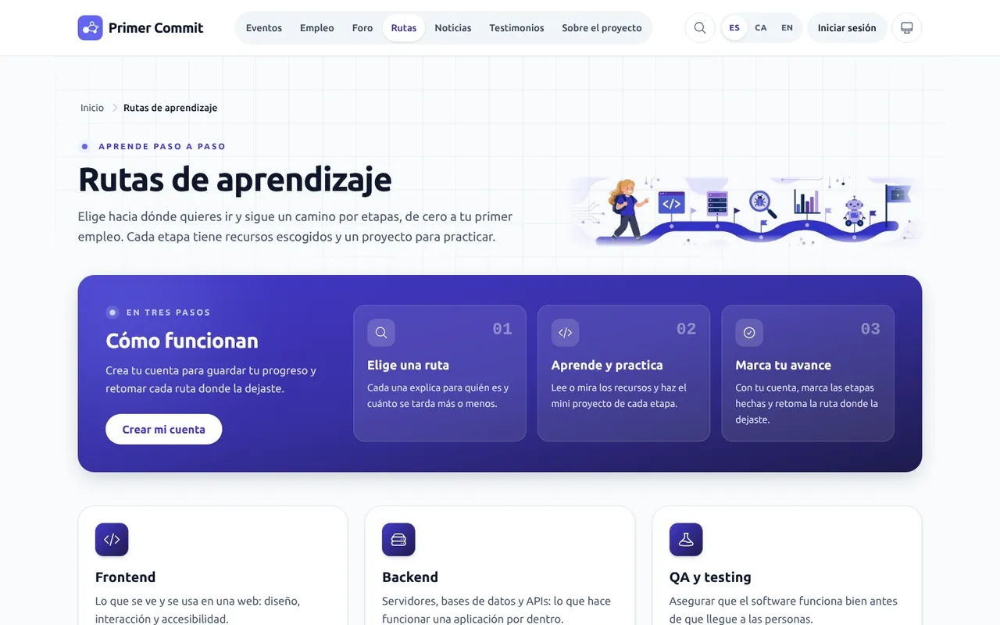 |
| **Noticias** | **Glosario** |
| 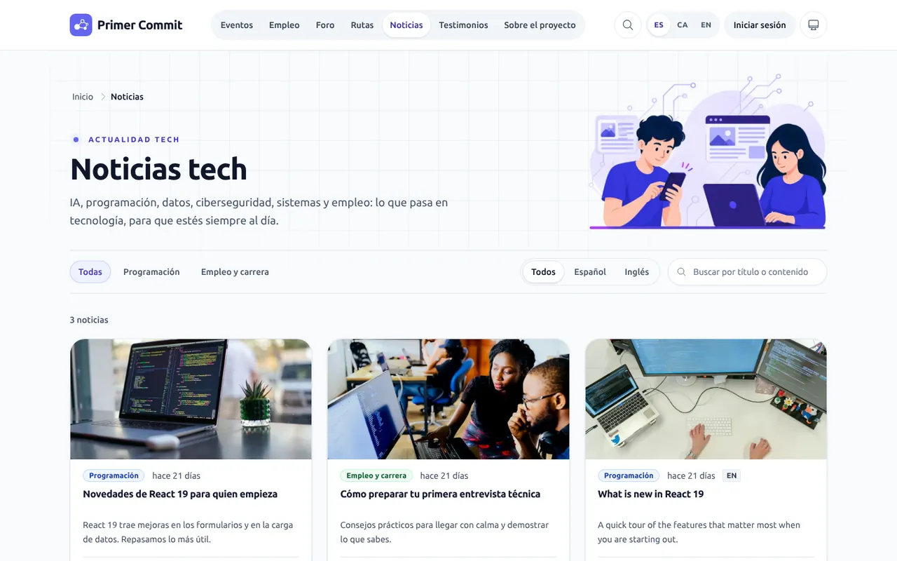 | 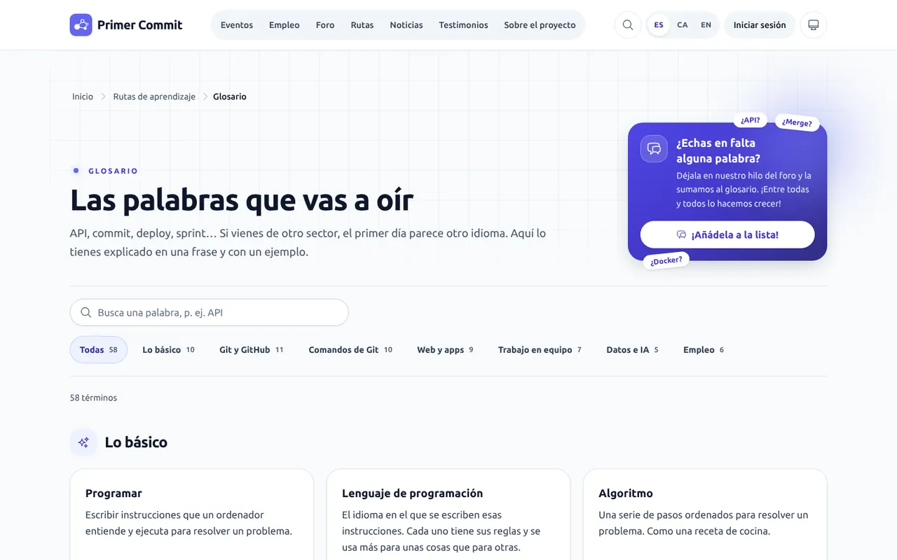 |
| **Testimonios** | **Perfil de la comunidad** |
| 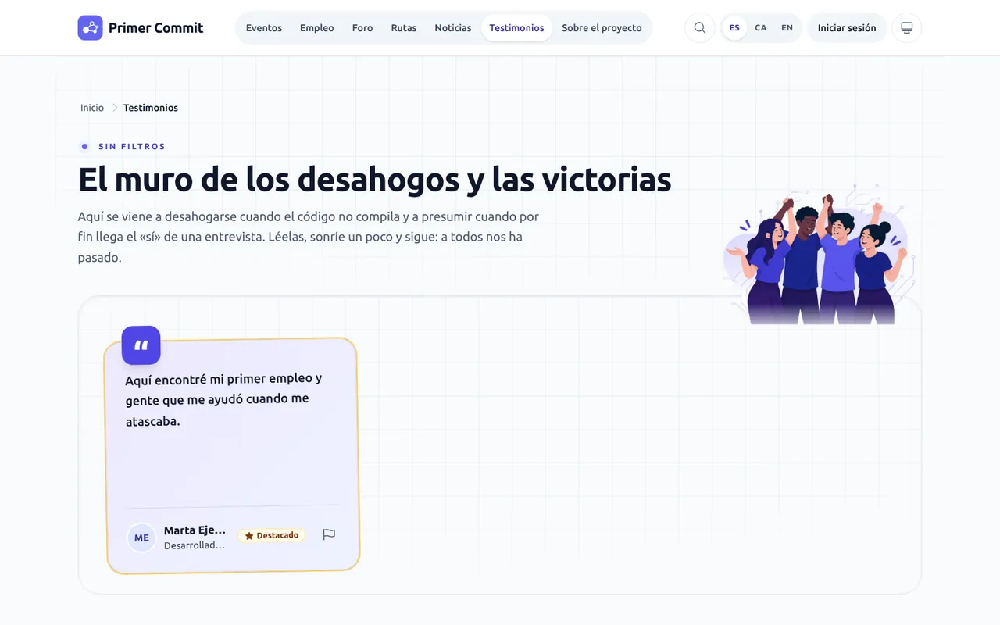 | 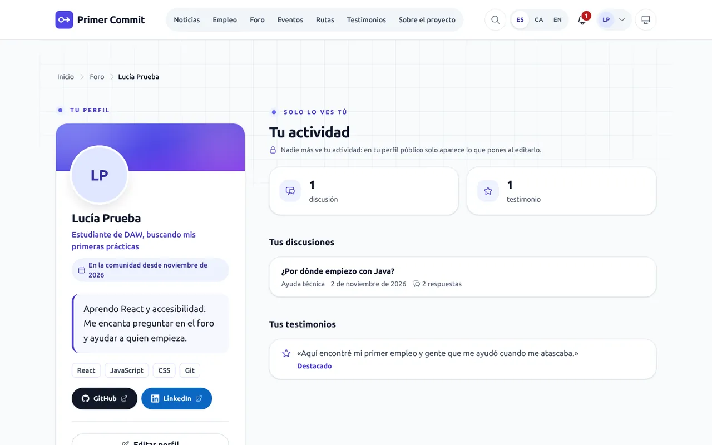 |

<p align="center">
  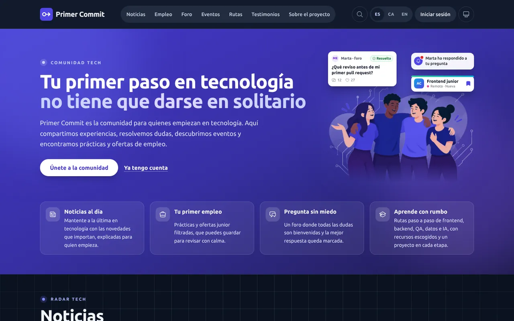
  &nbsp;&nbsp;
  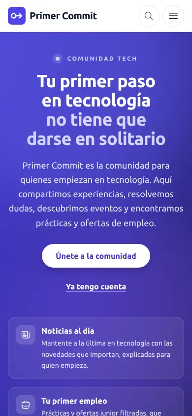
  &nbsp;&nbsp;
  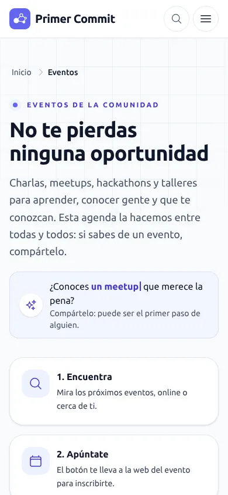
</p>

> Las capturas usan los datos de prueba de `e2e/data.js` (personas y contenidos inventados).

## Funcionalidades

**Para la comunidad**

- **Eventos** que comparte la comunidad: calendario, filtros por modalidad y ciudad, un bloque propio para
  comunidades de mujeres y «Me apunto» para ver cuánta gente va (nunca quién).
- **Empleo junior y prácticas** en España, con filtros por nivel, modalidad y contrato, ofertas guardadas, consejos
  para que te encuentren y guía para preparar entrevistas técnicas.
- **Foro**: discusiones por categoría, respuestas, «me gusta», mejor respuesta marcada por quien pregunta, edición,
  reportes y normas de convivencia siempre a la vista.
- **Rutas de aprendizaje** (frontend, backend, QA, datos e IA) por etapas, con recursos escogidos, un proyecto por
  etapa y progreso guardado.
- **Noticias** importadas de fuentes de confianza y clasificadas por tema (IA, programación, ciberseguridad,
  carrera...), con filtro de idioma, búsqueda y noticias relacionadas.
- **Glosario** de 58 términos explicados en una frase y con un ejemplo, con buscador e invitación a proponer palabras.
- **Testimonios** moderados antes de publicarse, y **perfiles** con presentación, tecnologías y enlaces.
- **Búsqueda global** desde la cabecera (Ctrl/⌘ + K), **notificaciones** de respuestas y mejores respuestas, inicio
  de sesión con email o **con Google**, verificación de email, recuperación de contraseña y borrado de la propia
  cuenta.

**Para la administración**

Panel en `/admin` con métricas y moderación de noticias, empleo, foro, testimonios, eventos, reportes, usuarios y
fuentes de importación. En **Reportes** aparece también lo que retiene el filtro de lenguaje, listo para publicarlo,
ocultarlo o borrarlo.

**Comunidad segura**

- **Filtro de lenguaje** en castellano, catalán e inglés: los insultos graves no se pueden publicar y las palabrotas
  leves dejan la discusión, el comentario o el evento pendiente de revisión (su autora lo ve marcado como «Pendiente
  de revisión»). El perfil y el nombre no admiten ninguna de las dos.
- **Tres reportes de personas distintas** ocultan un contenido hasta que la administración lo revisa.
- **Dependabot** avisa cada semana de dependencias con actualizaciones o fallos de seguridad conocidos.

**Privacidad por diseño**

La actividad de cada persona (discusiones, testimonios, contadores) solo la ve ella en su perfil; los eventos no
dicen quién los compartió. Solo almacenamiento técnico (la sesión), sin analíticas ni banner de cookies.

## Stack y principios

| | |
| --- | --- |
| **UI** | React 19 · react-router-dom 7 (rutas diferidas con `lazy` + `Suspense`) |
| **Estilos** | Tailwind CSS 3 con tokens de tema (`ink`, `canvas`, `surface`, `accent`...) y tema claro/oscuro |
| **Datos** | axios con un único cliente; hooks propios `useRequest`, `useAction` y `useForm` |
| **Build** | Vite 7 · ESLint 9 · Prettier |
| **Pruebas** | Vitest + Testing Library · Playwright + axe-core |
| **Tipografía** | Ubuntu servida desde la propia web (`@fontsource/ubuntu`, sin Google Fonts) |

Principios que se cumplen en todo el código (ver [`CLAUDE.md`](CLAUDE.md)):

- **HTML semántico estricto**: no hay ningún `<div>` (ESLint lo prohíbe). Cada elemento usa la etiqueta que expresa
  su significado: `section` con título, `article`, `aside`, `hgroup`, `menu`, `search`, `dl`, `figure`...
- **Accesibilidad WCAG 2.2 AA** comprobada con axe en tema claro y oscuro, escritorio y móvil.
- **Sin dependencias innecesarias**: nada de librerías de estado, formularios, UI ni iconos (los iconos son SVG
  propios).
- **Animaciones suaves y con propósito**, que se desactivan con «reducir movimiento».

## Puesta en marcha

Requisitos: **Node 20+** y el [backend](https://github.com/nexus-event-app/nexus-backend) escuchando en
`http://localhost:8080`.

```bash
npm ci
npm run dev
```

La web queda en `http://localhost:5173`. Vite hace de proxy de `/api`, `/uploads`, `/sitemap.xml` y `/robots.txt`
hacia el backend, así que el frontend usa siempre URLs relativas y no hay problemas de CORS.

## Scripts

| Script | Qué hace |
| --- | --- |
| `npm run dev` | Servidor de desarrollo con recarga en caliente y proxy al backend |
| `npm run build` | Compilación de producción en `dist/` |
| `npm run preview` | Sirve `dist/` en local |
| `npm run lint` | ESLint (sin errores ni avisos; incluye la regla «sin `<div>`») |
| `npm run check:i18n` | Comprueba que los tres idiomas tienen las mismas claves y variables |
| `npm run check:routes` | Comprueba la tabla de rutas por idioma en los dos sentidos |
| `npm test` | Pruebas unitarias y de componentes (Vitest) |
| `npm run test:coverage` | Lo mismo, con informe de cobertura |
| `npm run test:e2e` | Pruebas de extremo a extremo (Playwright, escritorio y móvil) |

## Calidad: pruebas, accesibilidad y CI

- **~300 pruebas unitarias y de componentes** junto al archivo que prueban (`Componente.test.jsx`). Se pinta con
  `renderWithProviders` (router, idioma, sesión y avisos) y se busca como lo hace una persona: `getByRole`,
  `getByLabelText`..., nunca por clases.
- **~290 pruebas de extremo a extremo** en `e2e/`, con la API simulada (`e2e/fixtures.js`) y datos de prueba
  (`e2e/data.js`). Se ejecutan en escritorio y móvil.
- **Accesibilidad automática**: `e2e/accesibilidad.spec.js` pasa axe (WCAG 2.2 AA) a las páginas principales en tema
  claro y oscuro.
- **Integración continua** (GitHub Actions, en cada push y pull request): lint, traducciones, rutas, pruebas
  unitarias, build y pruebas de extremo a extremo.

Antes de subir un cambio: `npm run lint`, `npm run check:i18n`, `npm run check:routes`, `npm test`,
`npm run test:e2e` y `npm run build`.

## Arquitectura

```
src/
  app/              Arranque: App, rutas (diferidas), layout, cabecera, menú, pie y scroll
  features/         Una carpeta por área: auth, home, news, jobs, forum, events, learning,
                    testimonials, profile, search, notifications, reports, about, legal, admin
                    (cada una con components/, hooks/, services/, pages/ y utils/)
  shared/
    api/            Cliente axios, ApiError y sesión
    components/     PageMain, DataTable, FormField, ActionMenu, Modal, Illustration, Seo...
    config/         Rutas (paths), catálogos, ilustraciones, datos legales
    hooks/          useRequest, useAction, useForm, useMediaQuery, useIsClamped...
    i18n/           Mensajes (es, ca, en), rutas por idioma y enrutado traducido
    utils/          Fechas, slugs, URLs seguras, texto
  test/             renderWithProviders y configuración de Vitest
e2e/                Pruebas de Playwright, API simulada y datos de prueba
scripts/            Comprobaciones de traducciones y rutas, y preparación de ilustraciones
docker/nginx/       Configuración de nginx para producción
```

Los servicios solo conocen el cliente HTTP; los hooks combinan servicio y estado; las páginas componen componentes.
Se importa con el alias `@/` (Vite y `jsconfig.json`).

**Conexión con el backend** (contrato completo en
[`docs/API.md`](https://github.com/nexus-event-app/nexus-backend/blob/dev/docs/API.md)):

- Identidad solo por JWT (`Authorization: Bearer ...`), que añade el interceptor de `shared/api/http.js`.
- Errores siempre en JSON `{ status, error, message, fieldErrors }`, normalizados a `ApiError`; los `fieldErrors` se
  pintan junto a cada campo.
- Un 401 limpia la sesión y los guards (`RequireAuth`, `RequireAdmin`) redirigen a iniciar sesión. Los guards solo
  mejoran la experiencia: la seguridad real la aplica el backend.
- Paginación 0-based en la API y 1-based en la URL (`?page=2`); los filtros van en la URL para poder compartirlos.
- Rutas con slug (`/noticias/12-titulo`): se extrae el `id` y se redirige al slug canónico si no coincide.
- Todo el texto de usuario se pinta como texto (React lo escapa); no se usa `innerHTML`.

## Idiomas

Castellano en la raíz, **catalán** en `/ca` y **inglés** en `/en`, sin librerías externas. Los textos están en
`src/shared/i18n/messages` y las secciones de la URL también se traducen: `/noticias` → `/ca/noticies` →
`/en/news`. En el código las rutas se escriben en castellano (`paths.news`) y los `Link`, `NavLink`, `Navigate` y
`useNavigate` de `@/shared/i18n` las traducen solos. El panel de administración y las páginas legales están solo en
castellano.

Las páginas cuyo contenido existe en los tres idiomas (portada, listados...) tienen canonical y `hreflang` propios;
las de contenido escrito por la comunidad o importado (detalle de noticia, oferta o discusión) apuntan con canonical a
la versión en castellano para no duplicar contenido (`<Seo translated={false} />`).

## Variables de entorno

Se definen en `.env` (plantilla en [`.env.example`](.env.example)). Son variables de **build**: se incrustan en la web
al compilar.

| Variable | Por defecto | Uso |
| --- | --- | --- |
| `VITE_API_URL` | `/api` | URL base de la API. Déjala así salvo que el backend esté en otro origen. |
| `VITE_SITE_URL` | `http://localhost:5173` | URL pública: canonical, Open Graph y JSON-LD. **El dominio real en producción.** |
| `VITE_BETA` | `false` | `true` muestra el aviso de versión beta bajo la cabecera. |
| `VITE_GOATCOUNTER_CODE` | (vacío) | Cuenta de GoatCounter para contar visitas sin cookies. Vacío, no se cuenta nada. |
| `VITE_LEGAL_OWNER_NAME`, `VITE_LEGAL_EMAIL` | vacías | Titular y email del aviso legal y la privacidad (LSSI y RGPD). |
| `VITE_LEGAL_OWNER_ID`, `VITE_LEGAL_ADDRESS` | vacías | NIF y domicilio. Opcionales: si están vacíos, no se muestran. |
| `VITE_LEGAL_HOSTING_PROVIDER` | vacía | Proveedor de alojamiento, como encargado del tratamiento. |

Los datos legales **nunca van en el repositorio**: solo en el servidor o en el `.env` local, que Git ignora.

## Despliegue

En producción la web se sirve con **nginx** dentro de Docker (imagen `nginx-unprivileged`, usuario no root, puerto
8080). El despliegue completo (base de datos, backend, esta web y Caddy con HTTPS automático) está preparado en
[`nexus-backend/deploy`](https://github.com/nexus-event-app/nexus-backend/tree/dev/deploy): se publica cada cambio de
la rama `dev` con un solo comando (`./actualizar.sh`).

Para construir solo esta imagen:

```bash
docker build --build-arg VITE_SITE_URL=https://tu-dominio.example -t primercommit-frontend .
docker run -p 8080:8080 -e BACKEND_URL=http://backend:8080 primercommit-frontend
```

La plantilla `docker/nginx/default.conf.template` solo sustituye `BACKEND_URL` y configura: `try_files` para la SPA,
proxy de `/api/`, `/uploads/`, `/sitemap.xml` y `/robots.txt`, caché inmutable para `/assets/`, gzip, cabeceras de
seguridad (CSP restrictivo, `X-Frame-Options`, `Referrer-Policy`, `Permissions-Policy`...) y `/healthz` para el
healthcheck.

## SEO

- Componente `Seo` en todas las páginas: título único, meta description, canonical absoluto, `robots`, Open Graph y
  Twitter Card.
- `noindex` en el panel, el login, el registro, la 404 y los listados con filtros o búsqueda.
- Datos estructurados JSON-LD: `WebSite`, `Organization`, `NewsArticle`, `JobPosting`, `DiscussionForumPosting` y
  `BreadcrumbList`.
- `sitemap.xml` y `robots.txt` los genera el backend (con las URLs de los tres idiomas).
- Rendimiento: rutas diferidas, imágenes con tamaño reservado y carga diferida, ilustraciones en WebP y esqueletos de
  carga para evitar saltos.

**Limitación conocida:** es una SPA renderizada en el navegador. Google la indexa, pero los rastreadores de redes
sociales no ejecutan JavaScript y solo ven los metadatos generales de `index.html`. La mejora recomendada es
prerenderizar las rutas públicas o migrar a un framework con renderizado en servidor reutilizando `features/` y
`shared/`.

## Decisiones de diseño

- **Sin estado global de servidor**: cada pantalla pide sus datos con `useRequest`, que cancela las peticiones
  obsoletas y evita condiciones de carrera.
- **Sesión en `localStorage`** (token y usuario), validada al arrancar con `GET /api/auth/me` y sincronizada entre
  pestañas. Es la opción más simple; la alternativa más robusta frente a XSS sería una cookie `HttpOnly`.
- **Identidad visual**: logo de nodos conectados (la comunidad), cabecera clara en índigo y la tipografía Ubuntu. El
  logo está en `src/shared/components/Logo.jsx` y en `public/` (favicon, iconos del móvil e imagen para redes).
- **Ilustraciones sin fondo propio**, preparadas con `scripts/ilustracion-sin-fondo.py` para que se vea el fondo de la
  web en claro y en oscuro, y registradas en `src/shared/config/illustrations.js`.
- **El texto de la interfaz, siempre traducido**: ninguna cadena visible fuera de `src/shared/i18n/messages`; la CI
  lo comprueba.

---

<p align="center">
  Hecho con cuidado para quienes empiezan · <a href="https://primercommit.es">primercommit.es</a>
</p>
